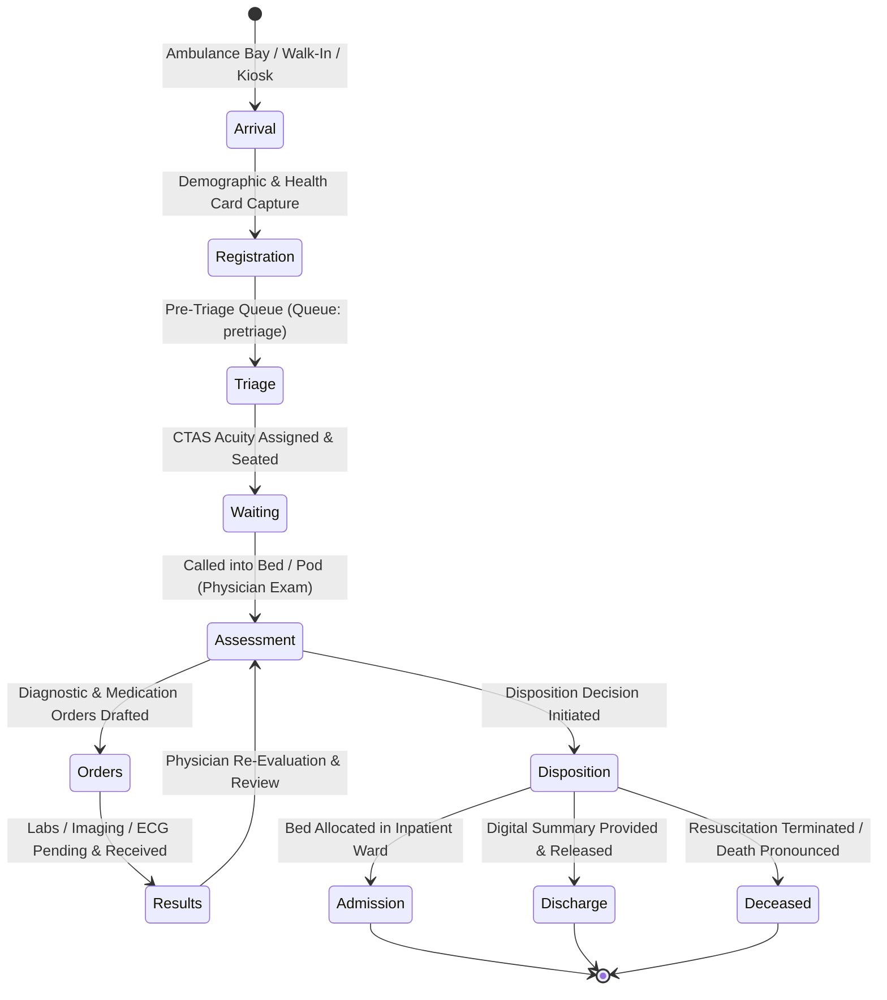
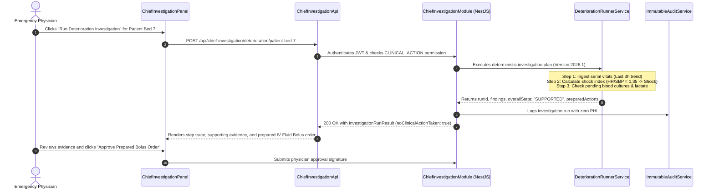
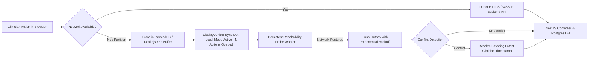

# CareDroid Clinical Intelligence Platform — Authoritative Application Flow, State Transitions & Journey Specification

**Document Version:** 3.1.0  
**Status:** Canonical Clinical Journey & UX Implementation Specification  
**Lead Authors:** UX/Product Design Lead, Principal Healthcare Informatics Architect, Chief AI Architect, QA Lead, SRE Lead  
**Classification:** Enterprise Healthcare Architecture & Due Diligence Authority  
**Target Platform:** Single Application Model (`caredroid-ed`) — Vite + React 18 + TypeScript + NestJS TypeORM

---

## 1. Master Application Flow Overview

CareDroid is engineered as a unified, single-application emergency healthcare operations platform (`caredroid-ed`). At the heart of the system is the **Emergency Whiteboard**, surrounded by tightly coupled operational rings: 911 dispatch ingestion, inbound EMS telemetry, self-arrival kiosk check-in, rapid reception intake, clinical triage, waiting room safety watch, physician decision support, diagnostic coordination, inpatient bed capacity, and operational analytics feedback.

All clinical workflows adhere to the **20-Stage Full Emergency Care Journey** (`src/services/fullEmergencyCareJourneyService.ts`), linking pre-hospital alerts to post-encounter continuous quality improvement.

```mermaid
flowchart TD
    subgraph PreHospital ["1. Pre-Hospital & Dispatch Domain"]
        S1["1. Emergency Event Signal\n(/emergency/dispatch)"] --> S2["2. 911 Contact & Caller Registry\n(/emergency/dispatch)"]
        S2 --> S3["3. Dispatcher Triage & CAD Protocol\n(/emergency/dispatch)"]
        S3 --> S4["4. Ambulance Dispatch & Turnout\n(/emergency/ems)"]
        S4 --> S5["5. EMS En Route Telemetry\n(/emergency/ems)"]
        S5 --> S6["6. Scene Arrival & ABC Survey\n(/emergency/ems)"]
        S6 --> S7["7. Prehospital Interventions\n(/emergency/ems)"]
        S7 --> S8["8. Pre-Arrival MIST Telemetry\n(/emergency/ems)"]
    end

    subgraph HospitalIntake ["2. Arrival & Intake Domain"]
        S8 --> S9["9. ED Readiness & Bay Reservation\n(/emergency/ed-readiness)"]
        S9 --> S10["10. Patient Arrival (Ambulance Bay)\n(/emergency/reception)"]
        WalkIn["Walk-In Arrival / Self-Check-in\n(/emergency/self-arrival)"] --> S10
        S10 --> S11["11. Rapid Intake & OCR Verification\n(/emergency/reception)"]
        S11 --> S12["12. Clinical Triage (CTAS I–V)\n(/emergency/reception?queue=pretriage)"]
    end

    subgraph AcuteCare ["3. Acute Care & Physician Decision Support"]
        S12 --> S13["13. AI Chief Review & Safety Watch\n(/emergency/copilot)"]
        S13 --> S14["14. Clinical Action & Whiteboard Pods\n(/emergency/whiteboard)"]
        S14 --> S15["15. Diagnostics Coordination (STAT/Labs/ECG)\n(/emergency/diagnostics)"]
        S15 --> S16["16. Treatment, Observation & Reassessment\n(/emergency/whiteboard)"]
    end

    subgraph DispositionOps ["4. Disposition, Inpatient & Analytics"]
        S16 --> S17["17. Disposition Decision\n(/emergency/referrals)"]
        S17 --> S18["18. Structured Handoffs (SBAR / Transfer)\n(/emergency/handoffs)"]
        S18 --> S19["19. Outcome Tracking (LWBS & Ministry Wait)\n(/emergency/reports)"]
        S19 --> S20["20. Analytics Feedback & Continuous Optimization\n(/emergency/analytics)"]
    end

    style PreHospital fill:#1e293b,stroke:#38bdf8,stroke-width:2px,color:#f8fafc
    style HospitalIntake fill:#0f172a,stroke:#34d399,stroke-width:2px,color:#f8fafc
    style AcuteCare fill:#1e1b4b,stroke:#818cf8,stroke-width:2px,color:#f8fafc
    style DispositionOps fill:#1c1917,stroke:#fbbf24,stroke-width:2px,color:#f8fafc
```



---

## 2. The 20 Stages of the Full Emergency Care Journey

The table below maps each of the 20 stages from `FULL_EMERGENCY_CARE_JOURNEY` to its responsible roles, active service modules, canonical routes, and clinical safety boundaries:

| #      | Journey Stage                | Primary Roles                               | Core Service Modules                                                      | Canonical Route                        | Target Outcome & Verification                                                                       | Clinical Safety Boundary                                                           |
| :----- | :--------------------------- | :------------------------------------------ | :------------------------------------------------------------------------ | :------------------------------------- | :-------------------------------------------------------------------------------------------------- | :--------------------------------------------------------------------------------- |
| **01** | **Emergency Event**          | Caller, Bystander, Facility Staff           | `EmergencySignalService`                                                  | `/emergency/dispatch`                  | Signal captured with source timestamp, geolocation, and life-threat indicators.                     | Signal validation only; does not replace local PSAP dispatch protocols.            |
| **02** | **Emergency Call / 911**     | 911 Dispatcher, Call Taker                  | `DispatchIntakeService`, `EmergencySignalService`                         | `/emergency/dispatch`                  | Caller details, complaint, callback number, scene hazards, and life-risk flags recorded.            | Dispatch intake support only; call-taker maintains conversational control.         |
| **03** | **Dispatcher Triage**        | 911 Dispatcher                              | `DispatchIntakeService`, `AIChiefService`                                 | `/emergency/dispatch`                  | Acuity priority, response tier, and pre-arrival bystander CPR/AED instructions documented.          | Deterministic priority scoring; human confirmation mandatory before unit dispatch. |
| **04** | **Ambulance Dispatch**       | Dispatcher, EMS Coordinator                 | `CADIntegrationService`, `EMSUnitService`, `StaffRoutingService`          | `/emergency/ems`                       | Paramedic unit assigned with GPS route, crew manifest, status, and turn-out countdown.              | Automatic assignment proposal requires dispatcher dispatch release.                |
| **05** | **EMS En Route**             | Paramedic Crew, EMS Coordinator             | `EMSUnitService`, `EmergencySignalService`                                | `/emergency/ems`                       | Paramedic terminal streams en-route telemetry, speed, route hazards, and real-time ETA.             | Real-time vehicle telematics; cellular/satellite failover enabled.                 |
| **06** | **EMS Arrival at Scene**     | Paramedic Crew                              | `PrehospitalAssessmentService`, `EMSUnitService`                          | `/emergency/ems`                       | Scene safety verified, initial ABCs (Airway, Breathing, Circulation), vitals, and red flags logged. | Paramedic physical assessment is ground truth; zero autonomous diagnosis.          |
| **07** | **Prehospital Care**         | Paramedic Crew                              | `PrehospitalAssessmentService`, `ThreeMinuteResponseService`              | `/emergency/ems`                       | Interventions (IV, oxygen, medications), serial vitals, and transport decision recorded.            | Clinical protocol guardrails ensure medication dosage checks en route.             |
| **08** | **Hospital Pre-Arrival**     | Paramedic, Charge Nurse, Triage Nurse       | `PreArrivalNotificationService`, `AIChiefService`, `CriticalAlertService` | `/emergency/ems`                       | Standardized MIST/SBAR packet received by ED; 1.6s visual/auditory pulse alert sounded.             | Pre-arrival alert enables room setup; does not create billing encounter.           |
| **09** | **ED Readiness**             | Charge Nurse, Flow Coordinator              | `EDReadinessService`, `DepartmentCapacityService`, `StaffRoutingService`  | `/emergency/ed-readiness`              | Trauma bay, specialty team (Code STEMI/Stroke), staff, and equipment reserved prior to arrival.     | Bay reservation requires charge nurse lock; prevents accidental double-booking.    |
| **10** | **Patient Arrival**          | Paramedic, Triage Nurse, Registration Clerk | `PatientIntakeService`, `EMSUnitService`                                  | `/emergency/reception`                 | Physical arrival verified; mode stamped (`walk-in`, `ambulance-arrival`, `transfer`, `kiosk`).      | Physical arrival initiates 3-minute emergency intake timer.                        |
| **11** | **Rapid Intake**             | Registration Clerk, Triage Nurse            | `PatientIntakeService`, `SmartIntakeService`                              | `/emergency/reception`                 | Minimum critical demographics, OHIP/health card OCR verification, and duplicate guard checked.      | If duplicate detected (409 Conflict), flags `PossibleDuplicate` for clerk review.  |
| **12** | **Clinical Triage**          | Triage Nurse                                | `TriageService`, `ThreeMinuteResponseService`                             | `/emergency/reception?queue=pretriage` | CTAS I–V score assigned based on vitals, age-adjusted z-scores, and nurse override.                 | Acuity recommendation is advisory; triage nurse retains legal authority.           |
| **13** | **AI Chief Review**          | Triage Nurse, Charge Nurse, ED Physician    | `AIChiefService`, `BottleneckRegistryService`                             | `/emergency/copilot`                   | Real-time risk synthesis, missing vital flags, bottleneck escalation, and next actions compiled.    | Level 4 HITL: AI offers recommendations; zero automated clinical actions.          |
| **14** | **Clinical Action**          | Registered Nurse, Emergency Physician       | `StaffRoutingService`, `CriticalAlertService`                             | `/emergency/whiteboard`                | Clinician reviews patient card, accepts/modifies recommendations, assigns bed/pod.                  | Whiteboard caps rendered cards at 18 for 60fps rendering performance.              |
| **15** | **Diagnostics Coordination** | ED Physician, Lab Tech, Radiologist         | `DiagnosticsCoordinationService`                                          | `/emergency/diagnostics`               | STAT lab orders, CT/X-Ray imaging requests, 12-lead ECG, and pharmacy reviews tracked.              | STAT escalations sound audio chimes if results exceed turn-around thresholds.      |
| **16** | **Treatment & Observation**  | Staff Nurse, Attending Physician            | `TriageService`, `CriticalAlertService`, `DepartmentCapacityService`      | `/emergency/whiteboard`                | Interventions, bedside vital reassessment cadence, and nursing observation notes logged.            | Reassessment timer alerts nurse if vitals elapse CTAS limit (e.g. 15m for CTAS 2). |
| **17** | **Disposition Decision**     | Emergency Physician, Specialist             | `HandoffService`, `DepartmentCapacityService`                             | `/emergency/referrals`                 | Disposition committed: Admit to Inpatient, Discharge Home, Transfer to Tertiary Care, OR, ICU.      | Physician digital signature required to finalize disposition status.               |
| **18** | **Structured Handoff**       | Staff Nurse, Paramedic, Inpatient Nurse     | `HandoffService`, `ReportingService`                                      | `/emergency/handoffs`                  | Electronic SBAR packet synthesized, verbal read-back confirmed, transfer checklist closed.          | Mandatory read-back confirmation prevents dropped handoff details.                 |
| **19** | **Outcome Tracking**         | QI Officer, Hospital Administrator          | `AnalyticsService`, `ReportingService`                                    | `/emergency/reports`                   | Total ED Length of Stay (LOS), door-to-doctor time, LWBS rate, and 3-min compliance tallied.        | Ministry of Health reporting compliance; operational aggregate data only.          |
| **20** | **Analytics Feedback**       | Medical Director, Hospital Admin, DevSecOps | `AnalyticsService`, `BottleneckRegistryService`                           | `/emergency/analytics`                 | Bottleneck patterns feed shift scheduling models, bed surge forecasts, and protocol updates.        | Continuous model improvement; zero model re-training without governance approval.  |

---

## 3. Core State Machines & Data Model Invariants

CareDroid enforces strict deterministic state machines across all frontend components, stores, and backend endpoints.

### 3.1 Patient Lifecycle State Machine (`PatientState`)

The patient lifecycle consists of 11 discrete states (`src/types/emergency.ts`):



#### State Transition Invariant Rules:

1. **No Phantom Patients:** A patient record cannot transition to `Triage` without a valid `arrivalMode` (`walk-in`, `ambulance-arrival`, `ems-prearrival`, `transfer`, `referral`, `staff-created-emergency`).
2. **Deterministic Triage Gate:** A patient cannot move from `Registration` directly to `Assessment` without undergoing `Triage` unless marked with validation mode `crash` (Immediate Resuscitation CTAS 1).
3. **Results Loopback:** When diagnostic results arrive (`Results`), the patient returns to `Assessment` status with an unread results badge until the attending physician reviews and dismisses the alert.
4. **Permanent Terminal States:** `Admission`, `Discharge`, and `Deceased` are terminal states; no further clinical orders or state regressions are allowed without an explicit administrative unlock.

---

### 3.2 Canadian Triage and Acuity Scale (CTAS) & Priority Tiers

CareDroid maps the 5 Canadian Triage and Acuity Scale tiers to internal `Priority` values, enforcing strict maximum waiting intervals:

| Priority Enum | CTAS Level | Clinical Acuity Name | Target Time-to-Physician  | Reassessment Cadence | Visual Token & Color                           |
| :------------ | :--------- | :------------------- | :------------------------ | :------------------- | :--------------------------------------------- |
| `Priority.P1` | **CTAS 1** | **Resuscitation**    | **Immediate (0 minutes)** | Continuous telemetry | `var(--cdl-color-p1)` (Crimson Red `#dc2626`)  |
| `Priority.P2` | **CTAS 2** | **Emergent**         | **$\le 15$ minutes**      | Every 15 minutes     | `var(--cdl-color-p2)` (Orange-Red `#ea580c`)   |
| `Priority.P3` | **CTAS 3** | **Urgent**           | **$\le 30$ minutes**      | Every 30 minutes     | `var(--cdl-color-p3)` (Amber Yellow `#d97706`) |
| `Priority.P4` | **CTAS 4** | **Semi-Urgent**      | **$\le 60$ minutes**      | Every 60 minutes     | `var(--cdl-color-p4)` (Forest Green `#16a34a`) |
| `Priority.P5` | **CTAS 5** | **Non-Urgent**       | **$\le 120$ minutes**     | Every 120 minutes    | `var(--cdl-color-p5)` (Slate Blue `#2563eb`)   |

---

### 3.3 Waiting Room Safety Watch & Fit-to-Wait Stratification

To eliminate waiting room deaths and reduce Left Without Being Seen (LWBS) rates, CareDroid implements the **Fit-to-Wait Pathway** (`src/services/fitToWaitPathway.ts`) for all patients in `PatientState.Waiting`:

```
+---------------------------------------------------------------------------------------------------+
| WAITING ROOM SAFETY WATCH (Strip on /emergency/reassessment & /emergency/whiteboard)              |
| [Total Waiting: 24]  [Fit to Sit: 16]  [Monitored Chair: 4]  [Stretcher: 2]  [ROOM NOW: 1 Critical] |
+---------------------------------------------------------------------------------------------------+
```

#### Canonical Classifications (`FitToWaitClassificationId`):

1. `fit-to-sit`: Stable for standard waiting room chair seating with routine CTAS-interval vitals recheck.
2. `monitored-chair`: Patient is seated in a designated high-visibility chair under direct sightline of the triage desk; telemetry pulse oximeter attached; reassessment interval halved.
3. `stretcher-needed`: Clinical frailty, severe pain, or orthostatic intolerance requires stretcher/recliner; patient cannot safely maintain chair posture.
4. `immediate-room-needed`: **CRITICAL ESCALATION**. Deteriorating vitals or clinical red flags require immediate physical exam bed placement; sounds auditory chime on Charge Nurse rail.
5. `reassessment-required`: Scheduled waiting room check elapsed or symptom changed; clinical nurse must reassess vitals before final seating disposition.

---

### 3.4 Operational Flags & Automated Deterioration Watch (`PatientFlag`)

The system monitors 15 real-time flags (`PatientFlag` in `src/types/emergency.ts`):

- `ReassessmentDue`: Reassessment timer has expired based on CTAS acuity level.
- `DeteriorationRisk`: Deterministic algorithm detected falling systolic BP, rising HR, or dropping SpO2.
- `ScoreReassessmentRecommended`: Significant interval elapsed since last qSOFA, NEWS2, or GCS score.
- `LongWait`: Patient wait time has exceeded the 90th percentile of ministry benchmark.
- `LWBSRisk`: Predicted high probability of patient leaving without being seen.
- `HighRisk`: Chief complaint contains flagged high-risk keyword (e.g. syncope, thunderclap headache).
- `PendingAdmission`: Inpatient admission ordered; bed allocation pending from hospital bed board.
- `EMSArrival`: Inbound or newly arrived EMS paramedic handover pending.
- `SepsisAlert`: System flagged combination of fever/hypothermia, tachycardia, tachypnea, and hypotension.
- `PsychAlert`: Behavioral health safety watch requiring dedicated observation.
- `Isolation`: Airborne/droplet/contact isolation precautions active (e.g. COVID-19, C. diff, measles).
- `DeterioratingNeuro`: Serial GCS score dropped by $\ge 2$ points or pupil asymmetry detected.
- `StrokeCode`: Acute neurological deficit with symptom onset $< 4.5$ hours; CT priority 1.
- `IdentityPending`: Unknown/unconscious patient arrived without verified legal name or health number.
- `PossibleDuplicate`: Backend SmartIntake duplicate guard flagged a potential identity match requiring human merge confirmation.

---

## 4. Personas, Landing Workspaces & Navigation Matrices

CareDroid organizes access into role-specific operational zones governed by `src/config/emergencyRolePermissions.ts` and `src/lib/users/canonicalAccess.ts`:

| Persona                    | Primary Canonical Workspace | Secondary Workspaces                                                                | Critical Operations & Actions                                                                                                                                      | Access Boundaries                                                                 |
| :------------------------- | :-------------------------- | :---------------------------------------------------------------------------------- | :----------------------------------------------------------------------------------------------------------------------------------------------------------------- | :-------------------------------------------------------------------------------- |
| **Emergency Physician**    | `/emergency/whiteboard`     | `/emergency/tools`<br>`/emergency/diagnostics`<br>`/emergency/referrals`            | Pod selection (All, Pod A, Pod B, Resus), patient inspection drawer, pediatric weight-based dosing, order signing, H&P note drafting, Chief Investigation trigger. | Cannot re-assign EMS CAD units or alter hospital facility license settings.       |
| **Triage Nurse**           | `/emergency/reception`      | `/emergency/queues`<br>`/emergency/reassessment`<br>`/emergency/whiteboard`         | Pre-triage queue intake, rapid vitals entry, CTAS acuity calculation, red flag overrides, fit-to-wait seating assignment, reassessment logging.                    | Cannot sign diagnostic prescription orders or finalize hospital discharges.       |
| **Charge Nurse**           | `/emergency/pulse`          | `/emergency/command-center`<br>`/emergency/whiteboard`<br>`/emergency/ed-readiness` | Department-wide surge monitoring, resus bay reservation, Code STEMI/Stroke paging, nurse workload rebalancing, EMS arrival coordination.                           | Full operational visibility across all ED pods and capacity corridors.            |
| **Registration Clerk**     | `/emergency/reception`      | `/emergency/self-arrival`<br>`/emergency/patients`                                  | Walk-in intake, health card OCR scan, identity verification, demographic lookup, duplicate candidate reconciliation.                                               | Strictly blocked from clinical triage scoring and medical order entries.          |
| **Paramedic / EMS**        | `/emergency/ems`            | `/emergency/dispatch`<br>`/emergency/handoffs`                                      | Inbound en-route telemetry transmission, pre-arrival MIST packet streaming, 12-lead ECG capture, hospital arrival transfer sign-off.                               | Read/write access limited to assigned transport vehicle and handoff packet.       |
| **Emergency Patient**      | `/emergency/self-arrival`   | N/A (Kiosk / Tablet)                                                                | Simplified 3-step check-in (Demographics, Reason for Visit, Pain/Distress), privacy screen, automated front-desk redirect on failure.                              | Sandboxed kiosk surface; no lateral navigation to clinical boards or EHR data.    |
| **Hospital Administrator** | `/emergency/command-center` | `/emergency/analytics`<br>`/emergency/reports`<br>`/admin`                          | Ministry wait-time compliance, LWBS metrics, 3-minute response compliance, ALC bed boarding bottlenecks, physician shift coverage.                                 | Read-only across PHI records; full administrative control over facility settings. |

---

## 5. End-to-End Clinical Sequences & User Journeys

### 5.1 Journey 1: Inbound EMS Telemetry, Pre-Arrival MIST & Resuscitation Bay Lock

```mermaid
sequenceDiagram
    autonumber
    actor Medic as Paramedic (Unit 402)
    participant EMSUI as EMS Console (/emergency/ems)
    participant PreService as PreArrivalNotificationService
    participant Signal as EmergencySignalService
    actor Charge as Charge Nurse
    participant CC as Command Center (/emergency/command-center)
    participant Ready as EDReadinessService
    participant Board as Whiteboard (/emergency/whiteboard)

    Medic->>EMSUI: Submits en-route telemetry (Suspected STEMI, SpO2 88%, BP 85/50, ETA 7m)
    EMSUI->>PreService: POST /api/sentinel/inbound (MIST Packet + 12-lead ECG)
    PreService->>Signal: Broadcast critical pre-arrival alert
    Signal-->>CC: Sounds 1.6s Auditory Pulse; Crimson Rail Highlights Unit 402
    Charge->>CC: Clicks Unit 402 card; reviews pre-arrival MIST & ECG snapshot
    Charge->>Ready: Clicks "Reserve Resuscitation Bay 1 & Activate Code STEMI"
    Ready->>Board: Lock Trauma Bay 1 as "RESERVED: Unit 402 STEMI"
    Ready-->>Charge: Auto-triggers Cardiology on-call pager & Cath Lab standby
    Medic->>EMSUI: Arrives at Hospital Ambulance Bay (GPS geofence triggers Arrival)
    Charge->>Board: Scans EMS transfer QR; confirms electronic handoff
    Board->>Board: Transitions patient from "Inbound" to "Active - Resuscitation" in Trauma Bay 1
```

- **Entry Point:** Paramedic field unit client en route; Charge Nurse monitoring `/emergency/command-center` or `/emergency/pulse`.
- **System Action:** Inbound telematics trigger continuous countdown; deterministic STEMI flags trigger high-contrast crimson banners.
- **Success:** Resuscitation Bay 1 locked; Code STEMI team assembled before vehicle wheels stop at the ambulance bay.
- **Recovery Path:** If vehicle ETA expires without arrival (+3m), system triggers overdue amber banner and prompts charge nurse to initiate radio check with EMS dispatch.

---

### 5.2 Journey 2: Self-Arrival Kiosk & Reception Smart Intake with Duplicate Guard

```mermaid
sequenceDiagram
    autonumber
    actor Patient as Arriving Patient
    participant Kiosk as Self-Arrival Kiosk (/emergency/self-arrival)
    participant Orch as ReceptionIntakeOrchestrator
    participant Guard as DuplicateDetectionEngine
    actor Clerk as Reception Clerk
    participant Desk as Reception Workspace (/emergency/reception)
    participant Queue as Pre-Triage Queue (/emergency/reception?queue=pretriage)

    Patient->>Kiosk: Selects language, scans Health Card, inputs chief complaint ("Crushing chest pain")
    Kiosk->>Orch: Submits intake payload (validationMode: "rapid")
    Orch->>Orch: Scans text for high-risk complaint keywords
    Note over Orch: Detected High Risk: "Crushing chest pain" -> Urgency CRITICAL
    Orch->>Guard: Check local store & backend for matching candidates
    alt Duplicate Candidate Identified
        Guard-->>Desk: 409 Conflict / Probable Match (Flag: PossibleDuplicate)
        Desk-->>Clerk: Displays split-screen duplicate review modal
        Clerk->>Desk: Verifies identity & merges records
    else Unique Patient Verified
        Guard-->>Orch: Zero conflicts
    end
    Orch->>Queue: Enqueues patient into Pre-Triage Queue; starts 3-min intake timer
    alt Backend Sync Fails / Network Offline
        Kiosk-->>Patient: Displays empathetic screen: "Please step directly to Front Desk Window 1"
        Orch->>Desk: Buffers encounter in IndexedDB with local fallback badge
    else Backend Sync Succeeds
        Kiosk-->>Patient: "Check-in Complete. Please take a seat in the waiting area. A nurse will call you shortly."
    end
```

- **Entry Point:** Hospital lobby kiosk terminal (`/emergency/self-arrival`) or receptionist desk (`/emergency/reception`).
- **Safety Rule:** High-risk complaints (chest pain, stroke symptoms, acute anaphylaxis) immediately elevate urgency suggestion to `critical`, triggering an attention strip on the triage nurse screen.
- **Error Recovery:** On backend write failure or network drop, the kiosk never displays technical stack traces. It immediately renders an accessible, high-contrast prompt directing the patient to Front Desk Window 1, while preserving entered data in local storage.

---

### 5.3 Journey 3: Nurse Clinical Triage & Acuity Scoring

```mermaid
sequenceDiagram
    autonumber
    actor Nurse as Triage Nurse
    participant UI as Triage Workspace (/emergency/reception?queue=pretriage)
    participant Engine as TriageDecisionEngine
    participant VitalsNorm as AgeAdjustedVitalsService
    participant Store as EmergencyStore
    participant WB as Whiteboard (/emergency/whiteboard)

    Nurse->>UI: Selects next patient from Pre-Triage queue (Jordan Reed, 34yo)
    UI-->>Nurse: Displays Triage Modal with pre-populated intake complaint
    Nurse->>UI: Inputs Vitals (HR 124, BP 88/54, SpO2 91%, RR 28, Temp 38.9°C, GCS 15)
    UI->>VitalsNorm: Calculate z-scores against age-adjusted physiologic norms
    VitalsNorm-->>Engine: Flags: Severe Tachycardia, Hypotension, Hypoxemia, High Fever (SIRS Criteria Met)
    Engine-->>UI: Recommends CTAS Acuity: Level 2 - Emergent (Sepsis Alert)
    Nurse->>UI: Reviews clinical justification; confirms CTAS 2; adds clinical note
    Nurse->>UI: Clicks "Assign Acuity & Place in Pod"
    UI->>Store: Commits triage record & dispatches WebSocket event
    Store->>WB: Places patient in Pod A queue with SepsisAlert badge
    UI-->>Nurse: Displays checkmark confirmation and auto-loads next waiting patient
```

- **Calculations:** Deterministic calculation of mean arterial pressure (MAP = 65 mmHg) and systemic inflammatory response syndrome (SIRS) criteria executed in $< 100$ms.
- **HITL Verification:** Triage nurse retains legal override authority to adjust CTAS tier up or down with mandatory typed rationale.
- **Handoff Parity:** Triage completion dispatches `intake_handoff_complete` and `arrival_control_sync` events, moving patient card to the whiteboard within 500ms.

---

### 5.4 Journey 4: Physician Whiteboard Pod, Patient Drawer & Pediatric Dosing Checker

```mermaid
sequenceDiagram
    autonumber
    actor MD as Emergency Physician
    participant WB as Whiteboard (/emergency/whiteboard)
    participant Drawer as Patient Inspection Drawer (480px)
    participant Calc as PediatricDosingEngine
    participant Orders as MedicationOrderDrafting

    MD->>WB: Filters by "Pod B - Acute"
    Note over WB: Virtual DOM renders exactly 12 active cards (Max 18 limit enforced)
    MD->>WB: Clicks Card (Liam Chen, 4yo, Otitis Media & Fever)
    WB-->>Drawer: Slides out 480px right-hand inspection drawer (background scroll locked)
    Drawer-->>MD: Shows Demographics, Verified Weight (16.0 kg), Allergies (NKDA), Vitals
    MD->>Drawer: Clicks "Pediatric Dosing Calculator"
    Drawer->>Calc: Queries weight-based guidelines for Amoxicillin
    Calc-->>Drawer: Computes: 90 mg/kg/day = 1,440 mg/day divided BID (720 mg PO BID)
    Note over Calc: Validated: Below adult max ceiling (1000 mg/dose); zero penicillin allergy
    MD->>Drawer: Clicks "Accept & Draft Order"
    Drawer->>Orders: Creates pending medication order draft with Canadian Paediatric Society citation
    MD->>Orders: Confirms order with 6-digit PIN confirmation
    Orders-->>WB: Updates Liam Chen card tag to "Meds Ordered"
```

- **DOM Performance Guarantee:** Whiteboard preview cards are strictly limited to `WHITEBOARD_CARD_PREVIEW_LIMIT = 18` in the active DOM viewport to maintain 60fps scrolling and avoid garbage collection pauses.
- **Safety Gate:** Pediatric calculation strictly blocked if patient weight is missing, zero, or negative. Weight input is highlighted with instant focus and high-contrast alert.

---

### 5.5 Journey 5: Chief Investigation Deterministic Deterioration Analysis



- **Autonomy Level:** Strictly restricted to `LEVEL_0_OBSERVE` and `LEVEL_2_PREPARE`. The engine gathers telemetry and prepares action proposals, but executes **zero autonomous clinical actions** (`noClinicalActionTaken: true`).
- **Evidence Trace:** Every finding is linked to explicit telemetry sources (`SUPPORTED`, `PARTIALLY_SUPPORTED`, `INSUFFICIENT_DATA`).

---

### 5.6 Journey 6: Inpatient Bed Allocation, Boarding & Structured Electronic Handoff

```mermaid
sequenceDiagram
    autonumber
    actor MD as Emergency Physician
    participant WB as Whiteboard (/emergency/whiteboard)
    participant Cap as DepartmentCapacityService (/emergency/capacity)
    actor Flow as Patient Flow Coordinator
    participant Inpatient as Inpatient Bed Board (/emergency/boarding)
    actor RN as Receiving Inpatient Nurse
    participant Handoff as HandoffService (/emergency/handoffs)

    MD->>WB: Sets patient disposition: "Admit to Internal Medicine"
    WB->>Cap: Patient state transitions to "Admission" (Queue: boarding)
    Cap->>Inpatient: Creates inpatient boarding request (Acuity: Telemetry, Isolation: None)
    Inpatient-->>Flow: Displays in pending bed allocation queue with boarding timer
    Flow->>Inpatient: Allocates Ward 4 East, Bed 12
    Inpatient-->>WB: Whiteboard reflects Bed 12 assigned; prompts ED nurse for handoff
    WB->>Handoff: ED Nurse initiates SBAR Structured Handoff
    Handoff-->>RN: Transmits digital SBAR summary (Situation, Background, Assessment, Recommendation)
    RN->>Handoff: Completes verbal read-back checklist & confirms acceptance
    Handoff->>WB: Handoff complete; patient departs ED; bed status resets to "Cleaning Needed"
```

- **Surge Awareness:** When total ED boarding patients exceed 15% of licensed capacity, `CommandCenterSurgePanel` automatically alerts the Chief Medical Officer and hospital operations executive.
- **Handoff Compliance:** Handoff requires two-way digital handshake: sender dispatch followed by receiver acceptance with recorded timestamp.

---

## 6. Offline Resiliency, Network Partitions & Error Recovery

CareDroid employs an **Offline-First Architecture** designed to withstand wide-area hospital network partitions and cloud connectivity blackouts.



### 6.1 Offline Capabilities

1. **72-Hour Local Storage Buffer:** Triage vitals, nursing notes, clinical calculator executions, and handoff checklists are persisted in browser IndexedDB.
2. **Deterministic Conflict Resolution:** When connectivity returns, local actions are played back sequentially against the server outbox. If a record was modified concurrently, the conflict resolver preserves the record with the most recent verified clinician timestamp, creating an audit note of the reconciliation.
3. **Visual Indicators:** The top utility bar pulse indicator provides immediate transparency:
   - **Green (Solid):** Fully connected to backend; live WebSocket streaming active.
   - **Amber (Flashing):** Local mode active; buffered transactions queued.
   - **Red (Solid):** Disconnected; actions stored locally; backend reachability probe running every 5 seconds.

### 6.2 Permission Denied (403 Forbidden) Architecture

If a user navigates to an unauthorized route or attempts an operation outside their role profile:

- System renders the standardized `AccessDeniedPanel` (`.cd-state--unsupported`).
- Plain-language explanation stating the required permission code (e.g. `MANAGE_STAFF_WORKFLOWS`).
- Actionable recovery: A single-click `Return to My Clinical Workspace` button routing the user back to their persona’s canonical home route.
- Zero white screens, zero console exceptions, zero exposure of backend stack traces.

---

## 7. Clinical Governance, Auditability & Regulatory Compliance

CareDroid strictly complies with Canadian digital health and international medical device software regulations:

### 7.1 Human-In-The-Loop (HITL) Level 4 Governance

- **Zero Autonomous Execution:** CareDroid never submits diagnostic orders, dispenses medications, assigns final CTAS acuity, or discharges patients autonomously.
- **Explicit Clinical Approval:** All AI-synthesized plans, dosing recommendations, and triage suggestions require physical click/PIN verification by a licensed practitioner.
- **Transparent Reasoning:** Every recommendation must present its underlying clinical rationale, reference guidelines (e.g. CPS, AHA, Thrombosis Canada), and input parameters.

### 7.2 Zero-PHI Audit Logging Architecture

- All API logs, frontend telemetry traces, error tracking events, and WebSocket payloads are purged of Protected Health Information (PHI).
- Audit logs record: `timestamp`, `actorUserId`, `roleProfileId`, `actionType`, `resourceType`, `syntheticEntityId`, `ipAddressHash`, and `executionTimeMs`.
- Compliance with Ontario **PHIPA**, Canadian federal **PIPEDA**, Quebec **Bill 64**, and **Health Canada SaMD Class II** standards.

---

_This application flow specification governs all UX implementation, routing logic, state machine controllers, and end-to-end integration tests across CareDroid._
