# CareDroid — Deployment & Infrastructure Architecture

**Document Version:** 3.0.0  
**Status:** Living Infrastructure Specification  
**Lead Authors:** DevSecOps Lead, Principal Systems Engineer, Cloud Infrastructure Architect  
**Platforms:** Kubernetes (EKS / AKS / OpenShift), Docker, AWS Canada Central, Azure Canada Central, On-Premise Air-Gapped LAN  
**Classification:** Enterprise Healthcare Architecture & Due Diligence Authority  

---

## 1. Multi-Enclave Deployment Topologies

To accommodate the stringent data residency, privacy regulations, and operational continuity mandates of acute healthcare networks, CareDroid supports three distinct deployment topologies:

```mermaid
flowchart TD
    subgraph Topology1["1. On-Premise Air-Gapped Enclave (Zero Internet Egress)"]
        LANWorkstations["Hospital Bedside Tablets & Desktops"] --> LocalK8s["On-Premise Kubernetes Cluster\n(OpenShift / k3s)"]
        LocalK8s --> LocalPG[("Local PostgreSQL HA (Patroni)")]
        LocalK8s --> LocalModel["Quantized Local Inference (vLLM / ONNX)"]
    end

    subgraph Topology2["2. Dedicated Canadian Cloud Enclave (AWS / Azure Canada)"]
        CloudClient["Secure VPN / DirectConnect"] --> WAF["Cloudflare WAF / Magic Transit"]
        WAF --> EKSCluster["Dedicated AWS EKS Cluster (Canada Central)"]
        EKSCluster --> AuroraPG[("Amazon Aurora PostgreSQL Multi-AZ")]
        EKSCluster --> ElastiCache[("Redis HA Cluster")]
    end

    subgraph Topology3["3. Hybrid Edge-Cloud Architecture"]
        BedsideEdge["Bedside Telemetry Monitors"] --> EdgeGateway["Clinical Edge Gateway (Hospital Pod)"]
        EdgeGateway -->|500Hz Local Processing| LocalAlerts["Bedside Alerts (<50ms)"]
        EdgeGateway -->|1Hz Downsampled mTLS VPN| CloudCentral["CareDroid Central Cloud Analytics"]
    end
```

---

## 2. Infrastructure as Code & Container Topologies

### 2.1 Container Specifications & Pod Topologies
- **Base Images:** Built on minimal, distroless hardened container images (`cgr.dev/chainguard/node:latest`) with non-root runtime users (`UID: 10001`).
- **Pod Replicas & Autoscaling:**
  - `caredroid-backend`: Horizontal Pod Autoscaler (HPA) configured for 3 to 20 replicas based on CPU (>70%) and WebSocket connection count (>1,000 sockets/pod).
  - `caredroid-frontend`: Static edge delivery via CDN or NGINX container cluster.
- **Resource Allocations:**
  - Backend API Pod: Requests `500m CPU / 1Gi RAM`; Limits `2000m CPU / 4Gi RAM`.

### 2.2 Health Probing & Liveness Checks
- **Liveness Probe (`GET /api/health/live`):** Checks process event loop responsiveness; fails if event loop lag exceeds 500ms.
- **Readiness Probe (`GET /api/health/ready`):** Validates database connection pool health, Redis cluster reachability, and active WebSocket listener status.

---

## 3. Secret Zero Policy & Configuration Management

1. **Zero Hardcoded Credentials:** Repositories, Dockerfiles, and container images contain zero passwords, API tokens, or encryption keys.
2. **Dynamic Secret Injection:** At pod initialization, secrets are fetched dynamically via Kubernetes External Secrets Operator linked to HashiCorp Vault or AWS Secrets Manager.
3. **Environment Segregation:** Complete physical and logical isolation between `development`, `staging`, and `production` environments.

---

## 4. Disaster Recovery & Multi-AZ Failover

- **Multi-AZ Replication:** PostgreSQL utilizes synchronous streaming replication across two availability zones with an asynchronous cross-region replica in AWS Canada West (Calgary) for catastrophic disaster recovery.
- **Recovery Point Objective (RPO):** < 1 minute for local AZ failure; < 15 minutes for regional catastrophe.
- **Recovery Time Objective (RTO):** < 15 minutes automated DNS failover via Route 53 health checks.

---

*This deployment specification defines the infrastructure standards and operational hosting requirements for CareDroid.*
