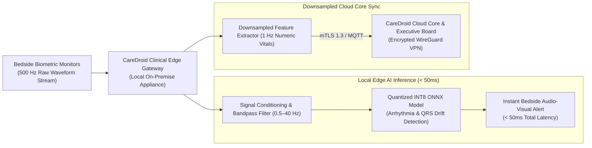

# CareDroid — Edge AI & Low-Latency Biometrics Processing

**Document Version:** 3.0.0  
**Status:** Living Edge Architecture Specification  
**Lead Authors:** Principal Embedded Systems Architect, Edge ML Engineer, Chief AI Architect  
**Runtimes:** ONNX Runtime, TensorRT, vLLM Local Engine, WebAssembly (Wasm)  
**Classification:** Enterprise Healthcare Architecture & Due Diligence Authority  

---

## 1. Edge Processing Rationale & Clinical Mandates

In acute resuscitation, trauma resuscitation, and neonatal emergency care, clinical decisions operate under tight temporal windows. Transmitting raw 500 Hz high-frequency waveforms (e.g. 12-lead ECG, arterial blood pressure lines) over wide-area internet connections introduces unacceptable hazards:
1. **Network Latency & Jitter:** Cloud round-trip latency (100–300 ms) fluctuates during peak internet congestion, delaying critical cardiac arrest detection.
2. **Bandwidth Saturation:** A 40-bed acute emergency department streaming raw 500 Hz biometrics consumes over 250 GB of bandwidth daily, saturating hospital uplink lines.
3. **Network Partitions:** Severe storms, construction line cuts, or hospital ISP outages must NEVER compromise bedside monitoring or patient deterioration alerts.
4. **Data Sovereignty:** Keeping high-resolution physiological signals on-premise eliminates accidental PHI leakage across public cloud networks.

---

## 2. Quantized Model Deployment & Edge Hardware Profiles

### 2.1 Hardware Appliance Profiles
- **Tier A (Department Server):** 1U Rackmount Server in hospital server room (Intel Xeon / AMD EPYC, 64GB ECC RAM, NVIDIA T4 / L4 GPU accelerator).
- **Tier B (Pod Appliance):** Industrial Fanless DIN-Rail PC installed in nursing pods (Intel Core i7 / Jetson Orin NX, 16GB RAM, Dual Gigabit NICs).

### 2.2 Model Quantization & Compilation
- **Inference Runtime:** ONNX Runtime with TensorRT execution provider.
- **Quantization:** Models are trained in PyTorch, exported to ONNX, and quantized to **INT8** precision via Post-Training Quantization (PTQ) with symmetric calibration.
- **Memory Footprint:** Quantized ECG arrhythmia classifier consumes < 45 MB of RAM and runs inference in 12 milliseconds per 5-second window.

---

## 3. Sub-50ms Local Biometric Feature Extraction

The edge pipeline computes physiological parameters continuously:
1. **R-Peak & Heart Rate Variability (HRV):** Pan-Tompkins algorithm optimized in C++ WebAssembly for sub-millisecond QRS complex identification.
2. **Ventricular Tachycardia (VT) & Fibrillation (VF):** Multi-scale wavelet transforms detecting chaotic waveforms within 1.5 seconds of onset.
3. **ST-Segment Elevation (STEMI Pre-Alert):** Automated measurement of J-point elevation across contiguous leads, flagging acute coronary occlusion prior to manual 12-lead interpretation.

---

## 4. Fail-Safe Offline Mode & Network Partition Recovery

- **Zero-Cloud Dependency:** If the hospital wide-area connection drops, the Clinical Edge Gateway maintains 100% of its local monitoring, scoring, and alerting functionality indefinitely.
- **Local SQLite Store:** Vitals, triage entries, and nurse notes are committed to an on-premise SQLite database.
- **Bi-Directional Conflict-Free Sync:** When connection is restored, synchronization utilizes Conflict-Free Replicated Data Types (CRDTs) to reconcile local and cloud states, ensuring clinician actions at bedside always take precedence.

---

*This specification governs all on-premise hardware deployments, edge runtime engines, and low-latency biometrics models across CareDroid.*
