# CareDroid — Healthcare Interoperability & Standards Specification

**Document Version:** 3.0.0  
**Status:** Living Interoperability Specification  
**Lead Authors:** Healthcare Informatics Architect, Chief Technology Officer, Systems Integration Engineer  
**Core Standards:** HL7 FHIR R4, HL7 v2.5.1, DICOM / DICOMweb, NEMSIS v3.5, SMART on FHIR  
**Classification:** Enterprise Healthcare Architecture & Due Diligence Authority  

---

## 1. Interoperability Principles & Vendor-Neutral Mandate

CareDroid is engineered as a vendor-neutral, provider-neutral medical intelligence platform. Modern acute hospitals operate disparate legacy infrastructure; CareDroid bridges these islands of data without proprietary lock-in.

```mermaid
flowchart LR
    subgraph HospitalEHR["Hospital Information Systems (HIS / EHR)"]
        Epic["Epic Systems (Interconnect / FHIR)"]
        Cerner["Oracle Cerner (Millennium / Ignite)"]
        Meditech["MEDITECH (Expanse FHIR)"]
        PACS["Hospital PACS (DICOMweb)"]
    end

    subgraph PreHospital["Pre-Hospital & Regional Services"]
        EMS["Ambulance CAD (NEMSIS v3.5)"]
        Provincial["Provincial Registries (Ontario Health / Netcare)"]
    end

    subgraph CareDroidGateway["CareDroid Interoperability Gateway"]
        FhirParser["HL7 FHIR R4 Translation Engine"]
        Hl7v2Bridge["HL7 v2.5 MLLP Ingestion Adapter"]
        DicomBridge["DICOMweb WADO-RS Metadata Extractor"]
        NemsisAdapter["NEMSIS v3 Inbound Telemetry Parser"]
    end

    subgraph CareDroidCore["CareDroid Clinical Operations"]
        Whiteboard["Live Emergency Whiteboard"]
        Triage["CTAS Triage & Vitals Engine"]
        Tools["Pediatric Dosing & CDS Calculators"]
    end

    HospitalEHR <-->|mTLS FHIR R4 / MLLP| CareDroidGateway
    PreHospital <-->|mTLS REST / MQTT| CareDroidGateway
    CareDroidGateway <--> CareDroidCore
```

---

## 2. HL7 FHIR Release 4 Core Mapping Matrix

CareDroid internal entities map bi-directionally to HL7 FHIR R4 resources:

| CareDroid Internal Entity | FHIR R4 Resource | Standard Vocabularies & Bindings | Key Resource Attributes Mapped |
| :--- | :--- | :--- | :--- |
| **Patient Profile** | `Patient` | Provincial Health System, Gender Codes | `identifier` (MRN, Provincial Card), `name`, `birthDate`, `gender`, `telecom`, `contact`. |
| **Emergency Encounter** | `Encounter` | `http://terminology.hl7.org/CodeSystem/v3-ActCode` | `class` (`EMER`), `status` (`in-progress`), `period` (arrival, discharge), `priority` (CTAS level). |
| **Vital Signs Stream** | `Observation` | LOINC (e.g. `8867-4` HR, `8480-6` SysBP, `2708-6` SpO2) | `category` (`vital-signs`), `code`, `valueQuantity`, `effectiveDateTime`, `performer`. |
| **Triage Acuity Assessment**| `Observation` | LOINC `75636-1` (CTAS Acuity Score) | `code`, `valueCodeableConcept` (CTAS 1–5), `interpretation`, `method` (algorithmic recommendation vs human override). |
| **Clinical Orders** | `ServiceRequest` / `MedicationRequest` | RxNorm / Canadian DIN, LOINC for labs | `status`, `intent` (`order`), `priority` (`stat` / `routine`), `medicationCodeableConcept`, `dosageInstruction`. |
| **Discharge Summary** | `Composition` / `Encounter` | LOINC `18842-5` (Discharge Summary) | `type`, `section` (Chief Complaint, Hospital Course, Discharge Medications, Follow-up). |

---

## 3. Legacy HL7 v2.5 MLLP Interface Adapter

For healthcare facilities operating legacy interface engines (Cloverleaf, Corepoint, Mirth Connect), CareDroid provides an MLLP (Minimal Lower Layer Protocol) adapter handling standard HL7 v2.5 message types:
- **ADT^A01 (Admit / Visit Notification):** Creates new active encounter in Reception and Triage queues.
- **ADT^A08 (Update Patient Information):** Updates demographics, insurance, or room assignment.
- **ADT^A03 (Discharge / End Visit):** Transitions encounter to discharged state and records bed departure timestamp.
- **ORU^R01 (Observational Result - Unsolicited):** Ingests lab test panels and critical panic values into patient inspection drawer.
- **MDM^T02 (Medical Document Management):** Ingests emergency physician dictation transcripts and signed notes.

---

## 4. Pre-Hospital EMS Telemetry & NEMSIS v3.5

Inbound ambulance data conforms strictly to the National Emergency Medical Services Information System (NEMSIS v3.5) data model:
- **eTimes:** `eTimes.03` (Unit Notified), `eTimes.06` (Unit En Route), `eTimes.09` (Unit Arrived Scene), `eTimes.11` (Unit Left Scene), `eTimes.12` (Hospital Bay Arrival).
- **eVitals:** Continuous serial vitals recorded during ambulance transport (`eVitals.06` Systolic BP, `eVitals.10` Heart Rate, `eVitals.12` SpO2).
- **eProtocols:** Field emergency protocol activations (e.g. suspected STEMI, acute Stroke protocol within 4.5h window, major trauma destination criteria).
- **Electronic Transfer of Care:** Two-party digital signature handshake timestamping legal transfer of responsibility from Paramedic to Emergency Department Registered Nurse.

---

## 5. Medical Imaging & DICOMweb Integration

CareDroid integrates with Hospital PACS (Picture Archiving and Communication Systems) via standard DICOMweb RESTful protocols:
- **QIDO-RS (Query based on ID for DICOM Objects):** Queries hospital PACS for emergency imaging studies matching the patient MRN (`GET /studies?PatientID={mrn}`).
- **WADO-RS (Web Access to DICOM Objects):** Retrieves DICOM metadata and losslessly compressed thumbnail frames for immediate inspection in the physician encounter drawer.
- **Stat X-Ray & CT Alerts:** Automatically updates whiteboard diagnostic status pills from `Imaging Ordered` -> `Imaging In-Progress` -> `Radiology Report Signed`.

---

## 6. Canadian Provincial Healthcare Registries (Planned)

CareDroid architecture includes modular gateway adapters designed for Canadian provincial digital health platforms:
1. **Ontario Health (eHealth Ontario):**
   - *Client Registry (CR):* Real-time validation of Ontario Health Card Numbers (OHCN) and version codes.
   - *ConnectingOntario ClinicalViewer:* Bi-directional viewing of historical provincial lab results, medication history via Digital Health Drug Repository (DHDR), and diagnostic reports.
2. **Alberta Health Services (AHS Netcare):**
   - *Alberta EHR Integration:* Querying Netcare clinical documents and diagnostic results for provincial emergency patients.
3. **British Columbia (CareConnect):**
   - *Provincial eHealth Viewer:* Integration with provincial laboratory and imaging data repositories.

---

## 7. Interoperability Security & Authorization

- **SMART on FHIR:** OAuth 2.0 authorization with scoped access tokens (`patient/Encounter.read`, `patient/Observation.write`).
- **Mutual TLS (mTLS 1.3):** Required for all direct server-to-server EHR interface connections.
- **Audit Compliance:** All external health records ingested or queried generate an immutable audit log entry recording practitioner identity, query timestamp, and patient identifier.

---

*This specification governs all external integration gateways, terminology maps, and healthcare messaging protocols across CareDroid.*
