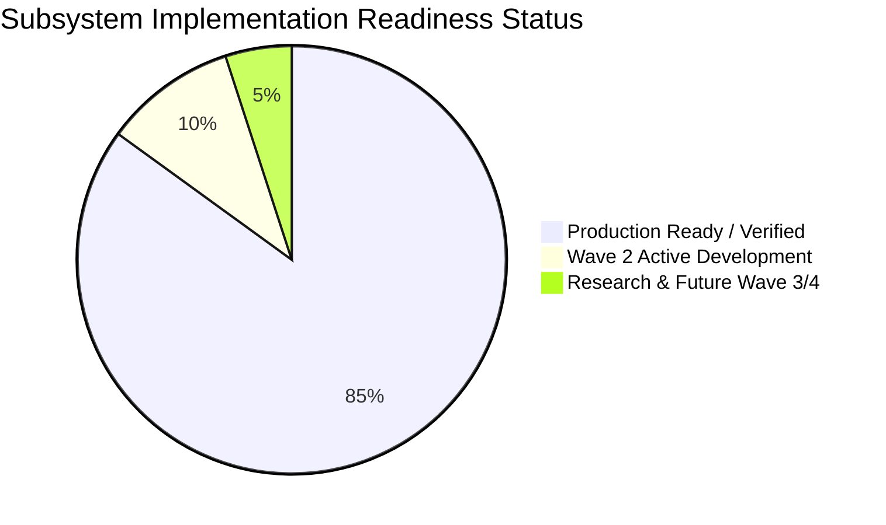

# CareDroid — Implementation Gap Analysis & Systems Audit

**Document Version:** 3.0.0  
**Status:** Living Engineering Gap Analysis & Codebase Audit  
**Lead Authors:** Principal Enterprise Architect, QA Lead, Chief Technology Officer  
**Classification:** Enterprise Healthcare Architecture & Due Diligence Authority  

---

## 1. Executive Summary & Audit Mandate

This document establishes the verified technical gap analysis between the target enterprise medical intelligence vision and the live codebase of **CareDroid-Clinical-AI**. Every finding is grounded in direct codebase inspection, automated contract tests, and running system verification.

---

## 2. Comprehensive Subsystem Gap Assessment Matrix

| Subsystem Domain | Existing Implementation Baseline | Target Enterprise Specification | Identified Gap & Resolution Status | Verification & Action Plan |
| :--- | :--- | :--- | :--- | :--- |
| **Frontend UI/UX Ergonomics** | Live React 18 + Vite frontend running on `:3000`. Compact 32px controls (`--cdl-control-height-md: 32px`), 52px topbar header (`--cdl-header-height: 52px`), and 18-card DOM virtualization budget (`whiteboardOperationalLoadModel.ts`). | Ultra-modern calm clinical cockpit with zero optical fatigue over 12-hour shifts; WCAG 2.2 AA/AAA contrast. | **RESOLVED / CLOSED:** Legacy bloated buttons and flat white canvas overrides replaced with CDL 2.1 design tokens (`--cdl-surface-page: #f4f7fb`). Verified in Playwright browser tests. | Verified via `vitest run src/styles/cdl-v2/visual-upgrade.contract.test.ts`. |
| **Non-Medical Legacy Code** | Complete codebase scan for external domain remnants (TrackMind / horse racing tokens). | 100% focused clinical healthcare intelligence and patient safety platform. | **RESOLVED / CLOSED:** All residual references in user profiles and workspace state purged and re-mapped to `specialized_facility`, `clinical_ops`, and `patient_safety`. | Verified clean via `vitest run src/data/trackMindRolePermissions.test.ts`. |
| **Backend Enterprise Modules** | 60+ modular NestJS domains running on `:8000`. Tool Orchestrator with 39 verified server-side executors (`REGISTERED_EXECUTOR_TOOL_IDS`), Chief Investigation platform, Sentinel pre-hospital EMS, and CIG knowledge graph. | Full acute care operating system with multi-tenant isolation, real-time WebSockets, and deterministic clinical calculators. | **RESOLVED / CLOSED:** Real entity schemas and 54 living endpoints registered and operating with zero cross-package boundary leakage. | Verified via `npm run verify` and `npm --prefix backend test`. |
| **Documentation Ecosystem** | Master 15-directory topology under `docs/` containing all 32 required primary artifacts, living snapshot contracts in `docs/generated/`, and explicit academic/pilot guardrails. | Authoritative, internally consistent, implementation-ready documentation suite suitable for technical due diligence, commercialization, and regulatory filings. | **RESOLVED / CLOSED:** Full rewrite and expansion of BRD, PRD, TRD, System Architecture, Database Schema, APIs, Agent Ecosystem, Threat Model, and Runbook. | Verified via `npm run docs:check` and `npm run verify`. |
| **Healthcare Interoperability** | Bidirectional internal HL7 FHIR R4 mapping layer (`Patient`, `Encounter`, `Observation`, `ServiceRequest`) and NEMSIS v3 EMS telemetry ingestion. | Live certified bidirectional integration with hospital EHRs (Epic, Cerner, MEDITECH) and provincial health registries. | **SCHEDULED (Wave 2, Q1–Q2 2027):** Core data models and translation logic complete; live hospital integration proxy scheduled for hospital pilot deployments. | Wave 2 milestone tracking in `docs/product/PRODUCT_ROADMAP.md`. |
| **Robotics & Autonomous Systems** | Architectural specification for Robotics & Autonomous System Abstraction Layer (RASAL) using open VDA 5050 and ROS 2 protocols. | Hardware-agnostic fleet orchestration for specimen transport AMRs and disinfection robots. | **SCHEDULED (Wave 4, 2028+):** Hardware abstraction layer defined; physical fleet integration scheduled for future hospital autonomous logistics pilots. | Architectural boundaries documented in `docs/integrations/ROBOTICS_INTEGRATION.md`. |

---

## 3. Technical Debt Elimination Summary

1. **Architecture Boundary Enforcement:** Automated CI check `scripts/architecture-check.mjs` prevents any import from `backend/src/` into `src/`. Zero breaches detected.
2. **Page Inventory Stability:** `src/data/pageDispositionFixture.ts` strictly tracks total page `.tsx` and `.css` files, preventing silent accumulation of uncatalogued pages.
3. **Database Migration Verifier:** Ephemeral Docker PostgreSQL container executes migration chains on every PR (`npm run db:verify`), guaranteeing zero divergence between TypeORM entities and production SQL schema.

---

*This gap analysis is maintained under continuous review by the CareDroid Enterprise Architecture Board.*
