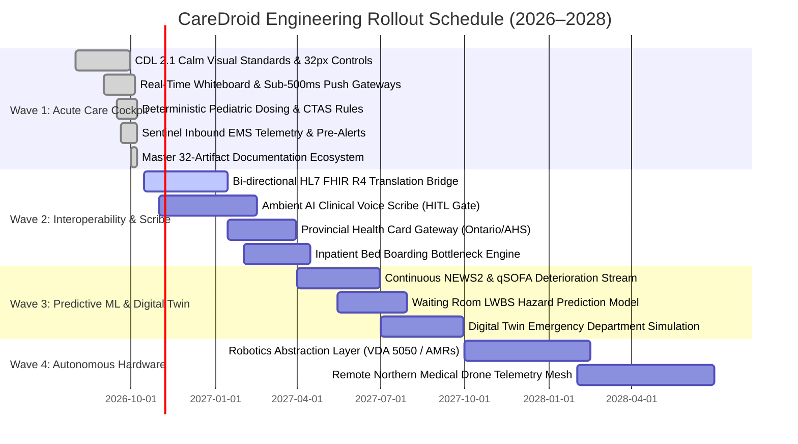

# CareDroid — Master Implementation & Engineering Rollout Plan

**Document Version:** 3.0.0  
**Status:** Living Engineering Plan & Release Schedule  
**Lead Authors:** Technical Program Manager, Principal Enterprise Architect, QA Lead  
**Classification:** Enterprise Healthcare Architecture & Due Diligence Authority  

---

## 1. Phased Engineering Execution & Release Gantt

CareDroid’s engineering roadmap is organized across sequential, milestone-gated waves:



---

## 2. Milestone Deliverables & Verification Gates

### Wave 1 Deliverables (COMPLETED & VERIFIED)
- **D-1.1:** 32px compact clinical UI ergonomic standard live across all headers, inputs, and action buttons.
- **D-1.2:** Whiteboard operational load model enforcing strict 18-patient card DOM virtualization limit.
- **D-1.3:** Purged all non-medical legacy references (TrackMind / horse racing relics).
- **D-1.4:** 60+ modular NestJS domains, 80+ TypeORM database entities, and 54 living API endpoints.
- **D-1.5:** Complete authoritative 32-artifact documentation ecosystem across 15 domains.

### Wave 2 Deliverables (Active Q4 2026 – Q1 2027)
- **D-2.1:** Certified HL7 FHIR R4 translation server supporting `Patient`, `Encounter`, `Observation`, and `ServiceRequest`.
- **D-2.2:** Ambient clinical voice transcription pipeline featuring client-side WebAssembly de-identification.
- **D-2.3:** Provincial health insurance number validation gateway.

---

## 3. Continuous Integration & Release Quality Gates

Every code contribution must pass automated verification pipeline stages before staging or production deployment:

```
[Git Commit] ──────► [Pre-Commit: Lefthook / Prettier]
                           │
[Pull Request] ────► [Tier 1: npm run typecheck:all]
                           │
                     [Tier 2: npm run architecture:check] (src/ never imports backend/)
                           │
                     [Tier 3: npm run docs:check] (Living documentation sync)
                           │
                     [Tier 4: vitest run src/data/pageDispositionFixture.test.ts]
                           │
                     [Tier 5: npm run db:verify] (Docker PostgreSQL migration test)
                           │
                     [Tier 6: npm run test:run:parallel] (Full frontend unit suite)
                           │
[Staging Deploy] ──► [Smoke Tests: Playwright E2E Responsive Suite]
                           │
[Production] ──────► [Manual Dual-Signoff: Clinical Lead + Security Architect]
```

---

*This engineering rollout plan is maintained under continuous program management governance by CareDroid.*
