# CareDroid — Medical IoT & Device Abstraction Architecture

**Document Version:** 3.0.0  
**Status:** Living IoT Specification  
**Lead Authors:** Principal Embedded Systems Architect, Healthcare Informatics Engineer, Clinical Safety Officer  
**Standards:** IEEE 11073 (MDC), MQTT 5.0, Bluetooth LE Health Profile, TLS 1.3  
**Classification:** Enterprise Healthcare Architecture & Due Diligence Authority  

---

## 1. Device Abstraction Layer (DAL)

CareDroid interfaces with acute care biometric devices, bedside vital monitors, smart stretchers, and infusion pumps through an extensible **Device Abstraction Layer (DAL)**. The DAL decouples proprietary manufacturer hardware protocols from clinical applications by converting incoming telemetry streams into standardized IEEE 11073 / HL7 FHIR Observation data structures.

```mermaid
flowchart LR
    subgraph Hardware["Clinical Bedside Hardware"]
        Monitor["Bedside Vital Monitor\n(Philips Intellivue / GE CARESCAPE / Mindray)"]
        Pump["Smart Infusion Pump\n(Baxter Spectrum / B. Braun Space)"]
        Stretcher["Smart Stretcher & Scale\n(Stryker ProCuity / Hillrom Progressa)"]
        Wearable["Continuous Biosensor Patch\n(ECG / SpO2 / Temp Patch)"]
    end

    subgraph EdgeGateway["CareDroid Clinical Edge Gateway (Local LAN)"]
        ProtocolAdapter["Protocol Normalizer\n(IEEE 11073 / Serial RS-232 / BLE)"]
        LocalFilter["Sampling Filter & High-Frequency Noise Rejection"]
        EdgeBuffer["Flash-Backed Local Circular Buffer\n(SQLite / LevelDB - 72h Capacity)"]
    end

    subgraph CloudCore["CareDroid Core Operations"]
        MqttBroker["MQTT 5.0 Telemetry Broker\n(mTLS 1.3 Ingestion)"]
        StreamEngine["Streaming Deterioration Analytics\n(qSOFA / NEWS2 Real-Time Calculator)"]
        WhiteboardTile["Active Whiteboard Vitals Tile\n(Sub-500ms Push to Nurse Pods)"]
    end

    Hardware --> ProtocolAdapter
    ProtocolAdapter --> LocalFilter
    LocalFilter --> EdgeBuffer
    EdgeBuffer -->|Encrypted WireGuard / MQTT 5.0| MqttBroker
    MqttBroker --> StreamEngine
    StreamEngine --> WhiteboardTile
```

---

## 2. Supported Device Classes & Parameter Telemetry

| Device Class | Physiological Parameters | Sampling Rate | Transport Protocol | Clinical Alarm Threshold Triggers |
| :--- | :--- | :---: | :--- | :--- |
| **Multiparameter Bedside Monitor** | Heart Rate (ECG Lead II/V5), SpO2, Resp Rate | 1 Hz (Numeric) / 500 Hz (Waveform) | IEEE 11073 over TCP / Serial | HR > 130 or < 40 bpm; SpO2 < 90% sustained > 15s; VTach / VFib alarm. |
| **Non-Invasive Blood Pressure (NIBP)** | Systolic BP, Diastolic BP, Mean Arterial Pressure (MAP) | Periodic Cycle (5, 15, 30 min) | IEEE 11073 / HL7 v2 | SBP < 90 mmHg (Hypotension shock) or > 180 mmHg (Hypertensive emergency); MAP < 65. |
| **Smart Infusion Pump** | Active drug DIN, infusion rate (mL/hr), volume infused | Event-Driven (Status Change) | IHE-PCD / MQTT | Line occlusion, air-in-line detection, rate deviation > 5% of ordered dose. |
| **Smart Stretcher / Scale** | Continuous patient weight (kg), bed exit status, head-of-bed angle | Event-Driven / Periodic (10s) | Proprietary / Bluetooth LE | Unassisted patient bed exit attempt (High Fall Risk); weight drop > 10 kg (Tare fault). |
| **Mechanical Ventilator** | Tidal volume, PEEP, FiO2, peak inspiratory pressure | 0.5 Hz | IEEE 11073 / Serial | Circuit disconnect, high peak pressure (>40 cmH2O), low minute volume. |

---

## 3. Alarm Fatigue Mitigation & IEC 60601-1-8 Compliance

CareDroid addresses the critical issue of clinical alarm fatigue by implementing strict multi-tier filtering compliant with IEC 60601-1-8 medical alarm standards:

1. **Transient Artifact Rejection:** Brief SpO2 drops (< 10 seconds) caused by patient movement or probe repositioning are filtered out before sounding acoustic alarms.
2. **Multi-Parameter Verification:** A low blood pressure reading is corroborated against current heart rate and pulse quality before triggering an automated sepsis alert.
3. **Escalation Cadence:** Alarms start as visual-only status pills on assigned nurse tablets; if unacknowledged within 60 seconds, they escalate to auditory pod alerts.
4. **Smart Latching:** Critical arrhythmias (Asystole, Ventricular Fibrillation) latch permanently until manually acknowledged by a clinician at bedside.

---

## 4. Edge Buffering & Offline Network Resiliency

To prevent data loss during hospital Wi-Fi dropouts or core wide-area network partitions:
1. **72-Hour Flash Buffer:** The Clinical Edge Gateway maintains an on-premise circular flash buffer (SQLite/LevelDB) storing all raw numeric vitals and device events.
2. **Store-and-Forward:** If cloud MQTT brokers become unreachable, the gateway transitions to offline mode, continuing to power local bedside alerts and pod tracking boards.
3. **Burst Synchronization:** Upon reconnect, the gateway streams compressed delta packets with monotonic sequence IDs, ensuring zero gaps in the patient longitudinal vital record.

---

## 5. Device Enrollment, Authentication & Security

- **Hardware Identity:** Every medical device is provisioned with an X.509 client certificate stored in a secure hardware element (TPM 2.0 / Secure Enclave).
- **Mutual TLS (mTLS 1.3):** All device-to-gateway and gateway-to-cloud connections require mutual cryptographic authentication.
- **Zero Inbound Ports on Bedside Devices:** Bedside gateways establish outbound connections only; no open listening ports exist on the hospital clinical LAN.

---

*This specification defines the medical device abstraction, biometric streaming, and telemetry standards for CareDroid.*
