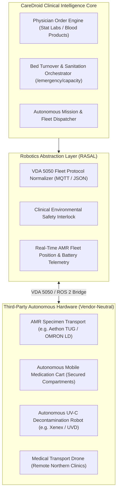

# CareDroid — Robotics & Autonomous Systems Integration Architecture

**Document Version:** 3.0.0  
**Status:** Living Robotics & Mission Integration Specification  
**Lead Authors:** Principal Autonomous Systems Architect, Enterprise Integration Lead, Biomedical Safety Officer  
**Standards:** VDA 5050 (v2.0 AMR Fleet Interface), ROS 2 (Humble/Iron), OMG DDS, MQTT 5.0  
**Classification:** Enterprise Healthcare Architecture & Due Diligence Authority  

---

## 1. Hardware Abstraction Mandate & Platform Boundaries

CareDroid is an enterprise intelligence, clinical workflow orchestration, and healthcare operations software platform. **CareDroid does NOT manufacture robotics, autonomous mobile robots (AMRs), or drone hardware.**

Instead, CareDroid provides a standardized, vendor-neutral **Robotics & Autonomous System Abstraction Layer (RASAL)**. RASAL enables hospitals to orchestrate mixed fleets of third-party robots (e.g. Aethon TUG, OMRON LD, Mobile Industrial Robots MiR, Keenon Healthcare, specialized medical transport drones) through open clinical mission protocols without vendor lock-in.

---

## 2. Standard Autonomous Clinical Missions

CareDroid models operational missions around four high-impact hospital workflows:

| Mission Class | Clinical Trigger Event | Autonomous Hardware Action | Safety Interlock & Verification Gate |
| :--- | :--- | :--- | :--- |
| **Stat Blood Specimen Transport** | Physician signs Stat Troponin order on Whiteboard | AMR navigates to Pod A Nurse Station, unlocks secure pneumatic drawer, transports specimen to Central Lab | Receiving lab technician must tap RFID employee badge to release specimen compartment. |
| **Emergency Medication Restock** | Triage nurse logs surge consumption in Resus Pod | Autonomous pharmacy cart delivers pediatric emergency dosing kits to Resuscitation Bay 1 | Dual RN biometric sign-off required to access controlled narcotics or high-alert medications. |
| **Rapid Bed Decontamination** | Patient discharged from Bed 7 (Infection Isolation) | Autonomous UV-C robot navigates to Bed 7, closes door, and runs verified 8-minute disinfection cycle | Thermal & LIDAR sensors verify zero human occupancy; any room entry instantly aborts UV-C emitter. |
| **Remote Northern Blood Resupply** | Severe trauma arrival in remote satellite clinic | Autonomous medical drone delivers O-negative packed red blood cells (PRBCs) in cold-chain box | Real-time GPS flight telemetry and temperature-logged cold-chain compliance recording. |

---

## 3. Communication Protocols & VDA 5050 Interface

All autonomous fleet orchestration adheres strictly to the **VDA 5050 AGV/AMR Interface Specification** (v2.0):

### 3.1 Standard Topics & Payloads
- **`uagv/v2/{manufacturer}/{serialNumber}/order` (Server -> Robot):**
  Dispatches mission instructions containing target destination node (e.g. `NODE_RESUS_BAY_1`), trajectory corridor, and clinical priority level (1 = Critical/Stat, 5 = Routine).
- **`uagv/v2/{manufacturer}/{serialNumber}/state` (Robot -> Server):**
  Continuous 1 Hz telemetry reporting robot coordinates ($x, y, floor$), battery percentage, compartment lock state, and active errors.
- **`uagv/v2/{manufacturer}/{serialNumber}/instantActions` (Server -> Robot):**
  High-priority override channel permitting immediate execution of emergency actions:
  - `ACTION_EMERGENCY_STOP`: Halts robot immediately in place.
  - `ACTION_CLEAR_CORRIDOR`: Commands robot to move to the wall during a hospital Code Blue or stretcher transit.

---

## 4. Clinical Safety Interlocks & Collision Avoidance

1. **Stretcher Right-of-Way:** Human patient transport stretchers and resuscitation teams always have absolute right-of-way over autonomous units. Robots detect moving beds via LIDAR and hold position.
2. **Elevator Interlock:** Robots communicate with hospital smart elevator dispatch systems via BACnet / OPC-UA to prevent boarding occupied passenger elevators.
3. **Sterility & Airflow Compliance:** AMRs do not enter positive-pressure Operating Rooms or Bone Marrow Transplant units without secondary air-shower decontamination verification.

---

*This specification defines the robotics and autonomous systems abstraction architecture for CareDroid.*
