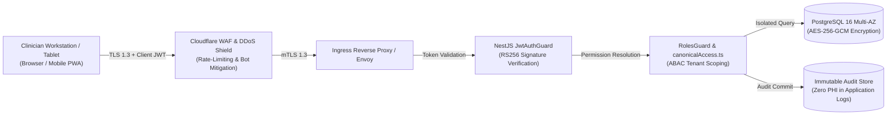

# CareDroid — Enterprise Security Architecture & Zero Trust Framework

**Document Version:** 3.0.0  
**Status:** Living Security Architecture Specification  
**Lead Authors:** Principal Security Architect, DevSecOps Lead, Chief Technology Officer  
**Compliance Standards:** Canadian PIPEDA, Ontario PHIPA, US HIPAA, SOC 2 Type II, ISO 27001  
**Classification:** Enterprise Healthcare Architecture & Due Diligence Authority  

---

## 1. Zero Trust Architectural Foundation

CareDroid operates on a strict **Zero Trust** security architecture: no user, device, network, or service is inherently trusted, regardless of whether requests originate within or outside the hospital perimeter. Every transaction is explicitly authenticated, authorized, validated, and logged.

---

## 2. Authentication, Session Lifecycle & Credential Security

### 2.1 Asymmetric Token Architecture
- **Access Tokens:** Short-lived JSON Web Tokens (15-minute expiration) signed using asymmetric **RS256** keys. Public keys are rotated quarterly; private keys reside in cloud hardware security modules (AWS KMS / Azure Key Vault).
- **Refresh Tokens:** Long-lived tokens (8-hour maximum lifetime) transmitted exclusively in secure, `httpOnly`, `SameSite=Strict`, `Path=/api/auth` cookies.
- **Refresh Token Rotation (RTR):** Every token refresh issues a new cryptographically random refresh token and invalidates the previous one. If a previously used refresh token is presented, the system triggers automated family revocation, immediately terminating all active sessions for that user.

### 2.2 Clinical Workstation Session Locks & Inactivity Timeouts
- **Clinical Workstation Lock:** Browser sessions in clinical areas automatically lock after **15 minutes** of keyboard/mouse inactivity. Workstations display a quick-PIN or RFID badge-tap unlock prompt, restoring the clinician's exact workspace context without losing unsaved triage drafts.
- **Public Kiosk Mode:** Self-arrival kiosks (`/emergency/self-arrival`) enforce a strict **60-second** inactivity timeout, wiping all temporary demographic form buffers to protect patient privacy.

---

## 3. Authorization Engine: Canonical RBAC & ABAC

Authorization is strictly governed by `src/lib/users/canonicalAccess.ts`. Introducing ad-hoc, secondary, or client-declared role systems is structurally prohibited.

### 3.1 Backend Role Hierarchy
- `PHYSICIAN`: Full read/write authority across patient records, clinical tool executions, and medication order drafting.
- `NURSE`: Authority to record vital signs, perform CTAS acuity scoring, allocate beds, and execute nursing workflows.
- `ADMIN`: Authority to configure department settings, manage staff rosters, and inspect operational metrics (no un-audited PHI access).
- `STUDENT`: Read-only access to anonymized or synthetic clinical cases; order drafting requires attending co-signature.

### 3.2 Tenant Isolation (ABAC)
- Multi-tenancy is enforced at the database query level via `@TenantScoped()` and `@OrganizationScoped()` decorators.
- The `TenantIsolationGuard` verifies that the `tenantId` in the practitioner’s JWT matches the `organization_id` of the requested clinical record, preventing cross-hospital data leakage.

---

## 4. Cryptographic Standards & Field-Level Encryption

| Data State | Protocol / Standard | Cipher Suite | Key Management |
| :--- | :--- | :--- | :--- |
| **In-Transit (Web & API)** | TLS 1.3 (Mandatory) | `TLS_AES_256_GCM_SHA384` | Automated Let's Encrypt / AWS ACM with 90-day rotation. |
| **In-Transit (Internal Services)** | Mutual TLS (mTLS 1.3) | `TLS_CHACHA20_POLY1305_SHA256` | HashiCorp Vault Internal PKI with 30-day certificate validity. |
| **At-Rest (Database & Caches)** | Block-level Volume Encryption | AES-256-XTS / AES-256-GCM | Cloud HSM Customer Managed Keys (CMK). |
| **Field-Level Encryption (PHI)** | Application Envelope Encryption | AES-256-GCM | Unique Data Encryption Key (DEK) per tenant; encrypted by Key Encryption Key (KEK). |

---

## 5. Non-Negotiable Audit Logging & Zero PHI Standard

CareDroid enforces an absolute separation between operational system logs and clinical patient records:

1. **Zero PHI in Application Logs:** Application stdout, console logs, and Winston log aggregators record operational metadata only (`timestamp`, `correlationId`, `userIdHash`, `action`, `statusCode`, `durationMs`). Logging patient names, dates of birth, MRNs, health card numbers, or clinical notes is blocked by custom sanitizing formatters.
2. **Immutable Audit Store:** Every clinical action, triage score override, medication calculation, and patient transfer is committed to an append-only PostgreSQL audit table (`workflow_action_log_entries`, `tool_result_audits`) replicated to write-once-read-many (WORM) storage.

---

*This document establishes the binding security architecture and compliance requirements for CareDroid.*
