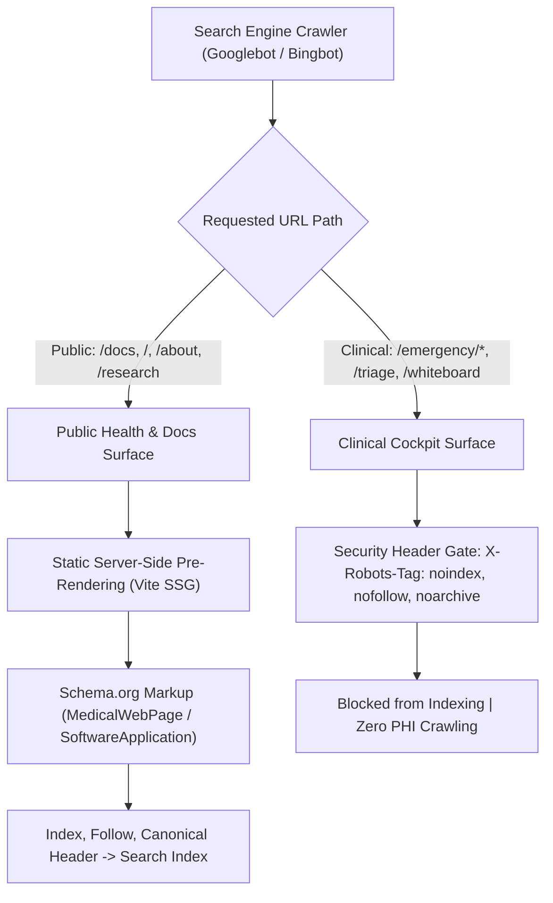

# CareDroid — SEO & Technical Health Portal Strategy

**Document Version:** 3.0.0  
**Status:** Living Technical Marketing & Discovery Specification  
**Lead Authors:** Technical Marketing Architect, Frontend Engineering Lead, Security Architect  
**Standards:** Schema.org (MedicalEntity / SoftwareApplication), Google Search Central Health Guidelines, WCAG 2.2  
**Classification:** Enterprise Healthcare Architecture & Due Diligence Authority  

---

## 1. Technical SEO & Medical Web Discovery Mandate

CareDroid maintains a strict architectural dual-perimeter strategy:
1. **Public Marketing & Medical Knowledge Portal:** Fully indexed, search-optimized, and structured using Schema.org healthcare vocabularies to establish CareDroid as an authoritative Canadian healthcare AI leader.
2. **Clinical Operational Workstations:** Sealed behind strict cryptographic access barriers, authenticated sessions, and non-negotiable search engine exclusion tags (`noindex, nofollow, noarchive`).



---

## 2. Structured Data Markup (Schema.org)

### 2.1 Schema.org `SoftwareApplication` (CareDroid Core Platform)
Embedded in public landing and product specification pages:
```json
{
  "@context": "https://schema.org",
  "@type": "SoftwareApplication",
  "name": "CareDroid Clinical AI",
  "operatingSystem": "Web, iOS, Android, Kiosk, Linux Edge",
  "applicationCategory": "MedicalBusiness",
  "applicationSubCategory": "Clinical Intelligence & Healthcare Operations",
  "description": "Enterprise medical intelligence and acute healthcare operations platform uniting real-time patient flow analytics, CTAS triage CDS, and pre-hospital EMS telemetry.",
  "softwareVersion": "3.0.0",
  "offers": {
    "@type": "Offer",
    "price": "0",
    "priceCurrency": "CAD",
    "availability": "https://schema.org/InStock"
  },
  "publisher": {
    "@type": "Organization",
    "name": "CareDroid Technologies Inc.",
    "url": "https://caredroid.ca"
  }
}
```

### 2.2 Schema.org `MedicalWebPage` (Clinical Evidence & Calculator Registry)
Embedded in public documentation for calculators (Wells, PERC, HEART, CTAS):
```json
{
  "@context": "https://schema.org",
  "@type": "MedicalWebPage",
  "name": "Canadian Triage and Acuity Scale (CTAS) Clinical Reference",
  "url": "https://caredroid.ca/docs/business/EVIDENCE_REGISTER.md",
  "aspect": "Evidence-based triage risk stratification algorithm",
  "medicalAudience": {
    "@type": "MedicalAudience",
    "audienceType": "Clinician"
  },
  "citation": [
    "https://doi.org/10.1017/s1481803500003057"
  ]
}
```

---

## 3. Strict Clinical Workstation Privacy Exclusions

To prevent any search engine from accidentally discovering, caching, or archiving active hospital operational data:

1. **HTTP Response Header Invariants:**
   All responses under `/emergency/*`, `/triage`, `/reception`, `/whiteboard`, `/patients`, `/tools`, and `/api/*` emit:
   ```http
   X-Robots-Tag: noindex, nofollow, noarchive, nosnippet, notranslate, noimageindex
   Cache-Control: no-store, no-cache, must-revalidate, private
   ```
2. **`robots.txt` Directives:**
   ```txt
   User-agent: *
   Disallow: /emergency/
   Disallow: /triage/
   Disallow: /whiteboard/
   Disallow: /reception/
   Disallow: /patients/
   Disallow: /tools/
   Disallow: /capacity/
   Disallow: /admin/
   Disallow: /api/
   Allow: /docs/
   Allow: /
   Sitemap: https://caredroid.ca/sitemap.xml
   ```

---

## 4. Core Web Vitals & Performance Optimization Budgets

To achieve top-tier Google Search ranking and maintain immediate accessibility during clinical presentations:

| Metric | Target Budget | Optimization Strategy |
| :--- | :--- | :--- |
| **Largest Contentful Paint (LCP)** | < 1.2 seconds | Pre-rendered static HTML, self-hosted fonts (`Inter`), inline critical CSS. |
| **Interaction to Next Paint (INP)** | < 50 milliseconds | Lightweight fiber rendering, zero long-running JavaScript tasks on the main thread. |
| **Cumulative Layout Shift (CLS)** | 0.00 (Zero Shift) | Explicit image aspect-ratio sizing, fixed shell height allocations (`--cdl-header-height: 52px`). |

---

*This specification governs all technical search engine optimization and public documentation indexing for CareDroid.*
