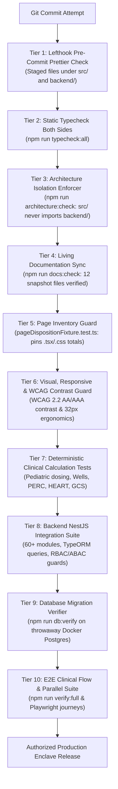

# CareDroid — Master Quality Assurance & Test Strategy

**Document Version:** 3.0.0  
**Status:** Living Engineering Test Strategy & Verification Authority  
**Lead Authors:** QA Lead, Principal Software Engineer in Test, DevSecOps Lead, Medical Informatics Director  
**Test Frameworks:** Vitest 1.6+ (Frontend), Jest 29+ (Backend), Playwright 1.44+ (E2E), TypeORM Migration Verifier  
**Classification:** Enterprise Healthcare Architecture & Due Diligence Authority  

---

## 1. Quality Philosophy: Zero Tolerance for Clinical Drift

In acute emergency healthcare, software defects do not merely cause customer inconvenience; they can lead to missed clinical deterioration, toxic pediatric medication overdoses, or delayed resuscitations. CareDroid enforces a **Ten-Tier Verification Pipeline** that must pass 100% clean before any code can merge to `main` or deploy to production.



---

## 2. The Ten Verification Tiers Detailed

| Tier | Quality Scope | Command / Automated Harness | Enforcement Gate |
| :--- | :--- | :--- | :--- |
| **Tier 1: Pre-Commit Style** | Staged source files in `src/` and `backend/` | `lefthook run pre-commit` (`prettier --check`) | Commit blocked locally if unformatted. |
| **Tier 2: Dual-Package Typecheck** | Complete TypeScript compilation without emit | `npm run typecheck:all` (`tsc -p tsconfig.json` & backend) | PR merge blocked on any type error or `any` leak. |
| **Tier 3: Architecture Isolation** | Verifies `src/` never imports `backend/src/` | `npm run architecture:check` (`scripts/architecture-check.mjs`) | PR merge blocked if cross-package boundary is breached. |
| **Tier 4: Living Documentation** | 12 snapshot files in `docs/generated/` | `npm run docs:check` (`scripts/check-living-documentation.mjs`) | PR merge blocked if implementation drifted from docs. |
| **Tier 5: Page Inventory Pinning** | Tracks total `.tsx` and `.css` files under `src/pages` | `vitest run src/data/pageDispositionFixture.test.ts` | Fails if pages were added without updating inventory pins. |
| **Tier 6: Visual & Contrast Guard** | Ergonomics, 32px controls, WCAG AA/AAA | `vitest run src/styles/cdl-v2/visual-upgrade.contract.test.ts` | PR merge blocked on contrast or token regression. |
| **Tier 7: Clinical Math Suite** | Pediatric dosing, GCS, Wells, PERC, HEART | `vitest run src/pages/tools/Calculators.test.tsx` | Immediate deployment block on any calculation variance. |
| **Tier 8: Backend Integration** | NestJS controllers, TypeORM services, guards | `npm --prefix backend test` | PR merge blocked on backend unit/integration failure. |
| **Tier 9: DB Migration Verifier** | Multi-step PostgreSQL migrations against schema | `npm run db:verify` (`scripts/db-verify.mjs`) | Fails if TypeORM entity differs from migration output. |
| **Tier 10: Full Verification** | Unified parallel suite + E2E journeys | `npm run verify:full` (`npm run test:run:parallel`) | Mandatory green gate for production release. |

---

## 3. Clinical Calculation Property-Based Testing Standards

Clinical calculations are subjected to rigorous property-based boundary testing:
1. **Weight Boundary Enforcement:**
   - Testing zero weight ($0.0\text{ kg}$) or negative values asserts that the calculation engine rejects the input with an explicit `CLINICAL_VALIDATION_ERROR`, never returning NaN or zero dose.
2. **Adult Maximum Ceiling Clamping:**
   - In pediatric simulations with patient weight exceeding $50\text{ kg}$ or $80\text{ kg}$, tests verify that the calculated dose is strictly clamped to the adult single-dose ceiling (e.g. Amoxicillin max $1,000\text{ mg/dose}$; Ceftriaxone max $2,000\text{ mg/dose}$).
3. **Allergy Cross-Reaction Hard Stops:**
   - Simulated encounters with documented cephalosporin or penicillin anaphylaxis assert that order drafting is blocked by a mandatory stop banner requiring pharmacist co-signature.

---

## 4. Test Execution Commands & Developer Workflow

```bash
# Run fast verification before pushing branch (Tiers 2, 3, 4, Linter, Knip)
npm run verify

# Run complete parallel frontend suite across multiple worker threads
npm run test:run:parallel

# Verify TypeORM migrations against throwaway Docker Postgres
npm run db:verify

# Generate a new migration if entities were modified
npm run db:migration -- AddNewClinicalField

# Execute full end-to-end release gate verification
npm run verify:full
```

---

*This test strategy governs all quality engineering, automated CI/CD checks, and release readiness gates for CareDroid.*
